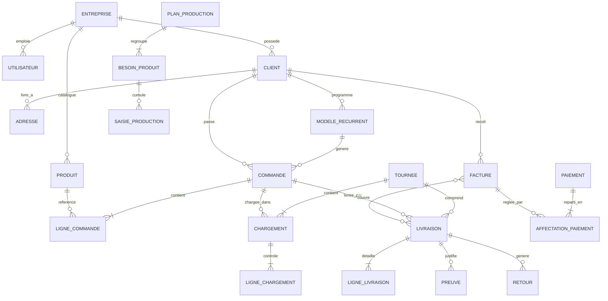
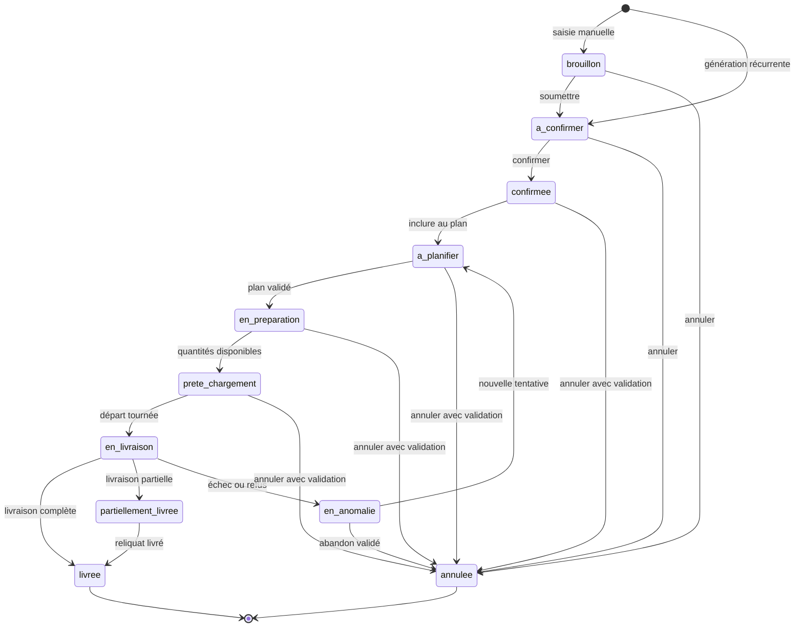
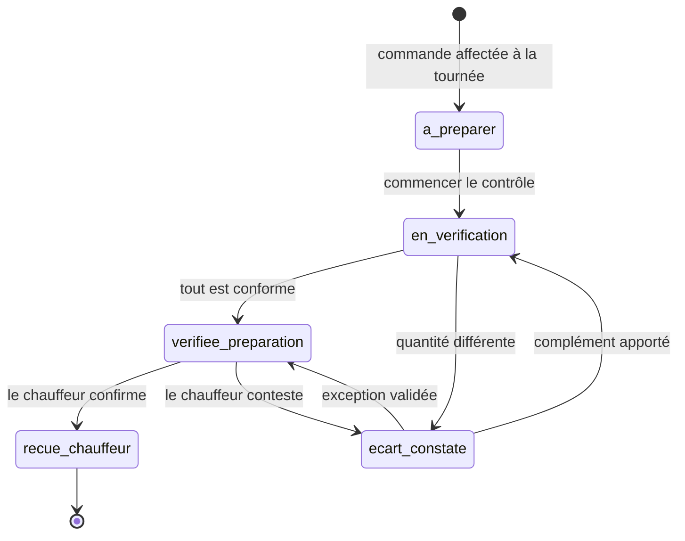
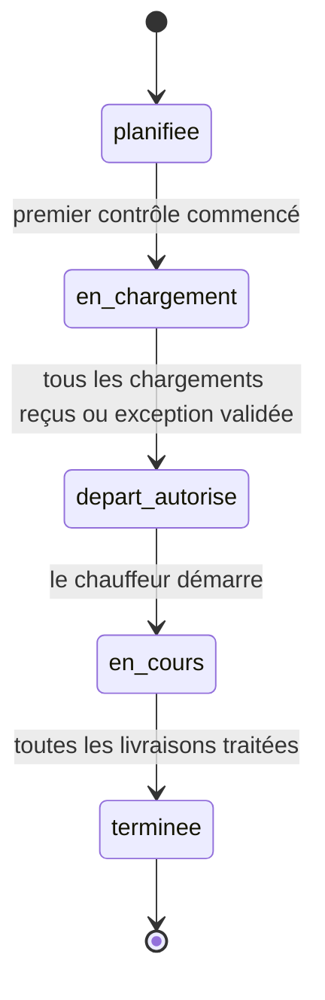
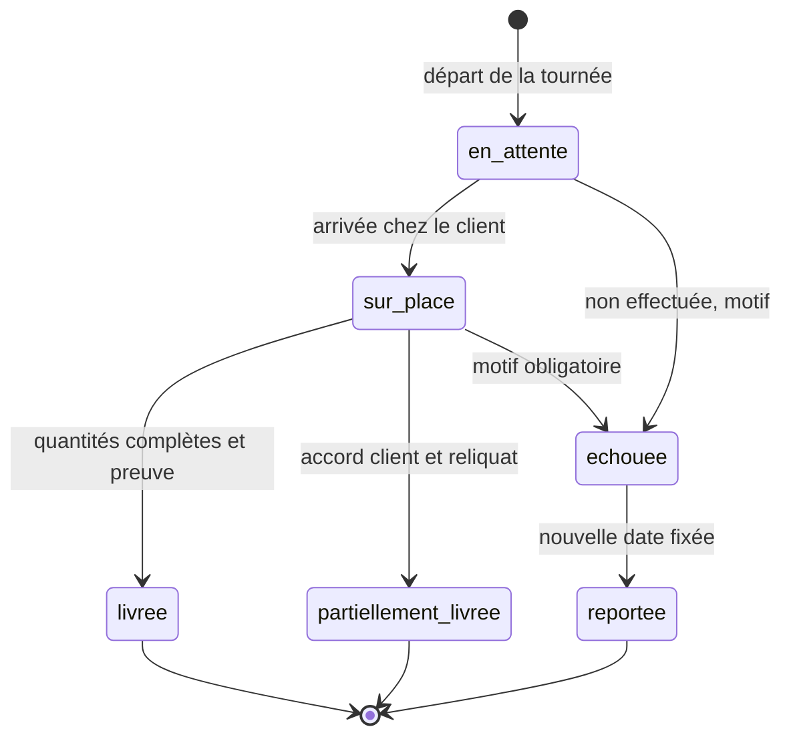

# ComandFlow — Modèle de données et diagrammes d'états

Version 0.1 · 14 octobre 2026 · Validé par Martial

## 1. Conventions de modélisation

Ces règles s'appliquent à tous les modèles. Elles traduisent directement les sections 4 et 18 du cahier des charges et doivent être en place dès le premier sprint.

| Règle | Mise en œuvre Django | Exigence couverte |
| --- | --- | --- |
| Multi-entreprise dès le départ | Classe abstraite `ModeleEntreprise` : FK `entreprise` + manager `objects` filtré sur l'entreprise de l'utilisateur connecté | §18 séparation des données, SaaS phase 3 |
| Traçabilité de base | Classe abstraite `ModeleTrace` : `cree_le`, `cree_par`, `modifie_le`, `modifie_par` | §4 « chaque action datée et associée à l'utilisateur » |
| Historique complet | `django-pghistory` sur les modèles sensibles (commande, lignes, chargement, livraison, facture, paiement) | §4 aucune modification silencieuse |
| Statuts protégés | `FSMField(protected=True)` : le statut ne change que par une transition déclarée | Sections 4 à 6 ci-dessous |
| Aucune suppression physique | `on_delete=PROTECT` partout ; annulation par statut ; référentiels avec champ `actif` | §8 « pas de suppression silencieuse » |
| Numéros métier lisibles | Clé interne `BigAutoField` + numéro métier par entreprise (`CMD-2026-000123`) généré par un modèle `Compteur` verrouillé avec `select_for_update()` | §8 numéro unique |
| Montants exacts | `DecimalField(max_digits=14, decimal_places=0)` en FCFA ; jamais de `FloatField` | §15 soldes exacts |
| Quantités | `DecimalField(max_digits=10, decimal_places=3)` + unité portée par le produit | Produits à l'unité ou au poids |
| Prix figé | `prix_unitaire` copié du catalogue sur chaque ligne de commande à la création | §7.2 |
| Fuseau horaire | `USE_TZ = True`, `TIME_ZONE = "Africa/Abidjan"` | Horodatage fiable |
| Décisions tracées | Modèle unique `Validation` (qui, quand, quoi, motif, preuve) relié aux objets par clé générique | §8 et §10 validations par un responsable |

## 2. Vue d'ensemble des relations

La commande est le pivot. Production, chargement, livraison, facture et paiement s'y rattachent, chacun avec son propre statut (principe §4).

Une commande peut avoir plusieurs chargements et plusieurs livraisons : c'est ce qui permet de gérer un reliquat livré dans une seconde tournée sans dupliquer la commande.

## 3. Modèles détaillés par application

Chaque modèle hérite de `ModeleEntreprise` et de `ModeleTrace` (section 1). Ces champs communs ne sont pas répétés ci-dessous.

### 3.1 `entreprises` et `comptes`

| Modèle | Champs principaux | Contraintes |
| --- | --- | --- |
| `Entreprise` | `nom`, `slug`, `ncc` (numéro de compte contribuable), `telephone`, `adresse`, `devise` (XOF), `options` (JSON : preuves activées, GPS, double validation) | `slug` unique |
| `Utilisateur` | hérite de `AbstractUser` + `entreprise`, `telephone`, `role_principal` | Un compte par personne, désactivation au lieu de suppression |
| `Compteur` | `entreprise`, `prefixe` (CMD, TRN, FAC…), `annee`, `dernier_numero` | Unique sur (`entreprise`, `prefixe`, `annee`) |

Les rôles sont des groupes Django (Direction, Gestionnaire, Commercial, Production, Préparation, Chauffeur, Facturation, Comptabilité, Prestataire) ; les règles objet passent par `django-rules`.

**Écrans par rôle** (validé le 18 octobre 2026). Un utilisateur qui a plusieurs rôles voit l'union de leurs écrans ; il arrive sur l'écran de son rôle principal. Le contrôle est fait côté serveur (`comptes/navigation.py`) : un écran non autorisé renvoie 403.

| Rôle | Écrans de bureau | Écran de terrain | Écran d'arrivée |
| --- | --- | --- | --- |
| Direction, Gestionnaire | Tableau de bord, Commandes, Récurrentes, Clients, Production, Tournées, Facturation, Paiements, Paramètres | — | Tableau de bord |
| Commercial | Tableau de bord (limité à ses commandes), Commandes, Récurrentes, Clients | — | Tableau de bord |
| Production | Production (plan groupé uniquement) | — | Production |
| Préparation | — | Contrôle du chargement | Contrôle du chargement |
| Chauffeur, Prestataire | — | Ma tournée (ses affectations uniquement) | Ma tournée |
| Facturation | Commandes, Clients, Facturation | — | Facturation |
| Comptabilité | Tableau de bord, Clients, Facturation, Paiements | — | Paiements |

La gestion des utilisateurs est une permission individuelle (`comptes.gerer_utilisateurs`), attribuée à l'utilisateur choisi quel que soit son rôle ; elle donne accès à Paramètres.

### 3.2 `clients` et `catalogue`

| Modèle | Champs principaux | Contraintes |
| --- | --- | --- |
| `Client` | `code` (CLI-000123), `nom`, `categorie` (restaurant, supermarché, particulier, revendeur, entreprise, événement), `telephone`, `ncc`, `conditions_paiement` (comptant, fin de mois, X jours), `delai_paiement_jours`, `notes`, `actif` | `code` unique par entreprise ; détection de doublons sur nom + téléphone |
| `ContactClient` | `client`, `nom`, `fonction`, `telephone` | — |
| `Adresse` | `client`, `libelle`, `adresse`, `commune`, `repere`, `latitude`, `longitude`, `consignes`, `par_defaut` | Une seule adresse par défaut par client |
| `Produit` | `code`, `nom`, `unite` (pièce, kg, carton…), `prix_reference`, `notes_preparation`, `actif` | `code` unique par entreprise |

### 3.3 `commandes`

| Modèle | Champs principaux | Contraintes |
| --- | --- | --- |
| `ModeleRecurrent` | `client`, `adresse`, `jours_semaine` (lun…dim), `creneau`, `date_debut`, `date_fin`, `actif` | — |
| `LigneModeleRecurrent` | `modele`, `produit`, `quantite` | — |
| `Commande` | `numero`, `client`, `adresse`, `canal` (WhatsApp, téléphone, sur place, commercial, bon écrit), `recue_le`, `date_livraison`, `creneau`, `urgente`, `instructions`, `modele_recurrent` (nullable), `statut` (FSM), `motif_annulation` | `numero` unique par entreprise |
| `LigneCommande` | `commande`, `produit`, `quantite`, `prix_unitaire` (figé), `montant` (calculé) | `quantite > 0` |
| `PieceJointe` | objet lié (clé générique), `fichier`, `type` (bon de commande, photo, justificatif) | Stockage privé |
| `Validation` | objet lié (clé générique), `action` (modification, annulation, urgence, substitution, écart, exception), `demandee_par`, `validee_par`, `decision`, `motif`, `date` | Validée par un profil habilité |

### 3.4 `production`

| Modèle | Champs principaux | Contraintes |
| --- | --- | --- |
| `PlanProduction` | `date_livraison`, `creneau` (optionnel), `statut` (brouillon, validé, clôturé), `valide_par` | Unique sur (`entreprise`, `date_livraison`, `creneau`) |
| `BesoinProduit` | `plan`, `produit`, `quantite_commandee` (calculée), `quantite_a_produire` (ajustable), `quantite_produite` (cumul calculé) | Unique sur (`plan`, `produit`) |
| `SaisieProduction` | `besoin`, `lot`, `quantite`, `saisie_le`, `saisie_par`, `commentaire`, `annulee`, `motif_annulation` | Jamais modifiée : une erreur se corrige par annulation + nouvelle saisie |

### 3.5 `logistique`

| Modèle | Champs principaux | Contraintes |
| --- | --- | --- |
| `Vehicule` | `immatriculation`, `libelle`, `actif` | Optionnel (option entreprise) |
| `Prestataire` | `nom`, `telephone`, `compte` (utilisateur, nullable) | — |
| `Tournee` | `numero`, `date`, `chauffeur` (utilisateur) ou `prestataire`, `vehicule`, `statut` (FSM), `depart_le`, `fin_le` | Un chauffeur ou un prestataire, pas les deux |
| `Chargement` | `tournee`, `commande`, `ordre_passage`, `statut` (FSM), `verifie_par`, `verifie_le`, `recu_par_chauffeur`, `recu_le` | Unique sur (`tournee`, `commande`) |
| `LigneChargement` | `chargement`, `ligne_commande`, `quantite_attendue`, `quantite_preparee`, `quantite_recue_chauffeur`, `ecart` (calculé) | — |
| `Livraison` | `chargement`, `commande`, `statut` (FSM), `arrivee_le`, `receptionnaire_nom`, `receptionnaire_fonction`, `motif_echec`, `commentaire`, `latitude`, `longitude`, `reportee_au` | Une livraison par chargement |
| `LigneLivraison` | `livraison`, `ligne_commande`, `quantite_prevue`, `quantite_livree`, `substitution_produit` (nullable) | `quantite_livree <= quantite_prevue` sauf validation |
| `Preuve` | `livraison`, `type` (photo bordereau, signature, code, GPS, numéro bordereau, autre), `fichier`, `valeur`, `capturee_le` | Au moins une preuve si l'option est obligatoire pour la catégorie de client |
| `AccordClient` | `livraison`, `objet` (partielle, substitution), `nom_client`, `moyen` (oral, signature, écrit), `preuve` | Obligatoire pour livraison partielle ou substitution |
| `Retour` | `livraison`, `produit`, `quantite`, `motif`, `etat` (revendable, à contrôler, abîmé), `decision`, `decide_par` | — |
| `Reliquat` | `commande_origine`, `ligne_commande`, `quantite`, `nouvelle_date`, `traite` | Rattaché à une prochaine tournée |

### 3.6 `facturation` et `paiements`

| Modèle | Champs principaux | Contraintes |
| --- | --- | --- |
| `Facture` | `numero_interne`, `client`, `livraisons` (M2M), `type_document` (FNE, autre document), `motif_sans_fne`, `numero_fne`, `date_document`, `montant_ht`, `montant_ttc`, `fichier`, `echeance`, `statut_paiement` (calculé), `choix_fait_par`, `choix_fait_le` | Choix FNE sans effet sur le statut de livraison |
| `Paiement` | `client`, `montant`, `date`, `mode` (espèces, virement, chèque, Mobile Money, autre), `reference`, `justificatif`, `annule`, `motif_annulation` | `montant > 0` |
| `AffectationPaiement` | `paiement`, `facture`, `montant` | Somme des affectations ≤ montant du paiement |

Le solde d'une facture = `montant_ttc` − somme des affectations non annulées. Le statut de paiement (non payé, partiel, payé, en retard) est calculé, jamais saisi à la main.

## 4. Machine à états — Commande

La commande ne passe en livraison que lorsque le chauffeur a confirmé le chargement. Les statuts aval (livrée, partielle, anomalie) sont posés par le système à partir de la livraison, jamais à la main.

| Transition | De → vers | Déclenchée par | Condition |
| --- | --- | --- | --- |
| `soumettre` | brouillon → a_confirmer | Commercial, gestionnaire | Client, adresse, date de livraison et au moins une ligne |
| `generer_du_jour` | (aucun) → a_confirmer | Système (tâche Celery chaque soir) | Modèle récurrent actif pour le jour J+1 |
| `confirmer` | a_confirmer → confirmee | Commercial, gestionnaire | Confirmation client enregistrée ; si urgente, `Validation` d'urgence approuvée |
| `inclure_au_plan` | confirmee → a_planifier | Système | Ajout au `PlanProduction` de la date de livraison |
| `lancer_preparation` | a_planifier → en_preparation | Système, à la validation du plan | Plan validé par le responsable de production |
| `marquer_prete` | en_preparation → prete_chargement | Gestionnaire, responsable production | Quantités réservées disponibles, ou `Validation` d'exception |
| `partir_en_livraison` | prete_chargement → en_livraison | Système, au départ de la tournée | Chargement de cette commande « reçu par le chauffeur » ou exception approuvée |
| `cloturer_livree` | en_livraison → livree | Système | Livraison au statut livrée, toutes quantités remises |
| `cloturer_partielle` | en_livraison → partiellement_livree | Système | Livraison partielle + `AccordClient` + `Reliquat` créé |
| `signaler_anomalie` | en_livraison → en_anomalie | Système | Livraison échouée, refusée ou client absent |
| `relancer` | en_anomalie → a_planifier | Gestionnaire | Nouvelle date et consigne saisies |
| `annuler` | brouillon, a_confirmer → annulee | Créateur, gestionnaire | Motif obligatoire |
| `annuler` | confirmee … prete_chargement → annulee | Gestionnaire, direction | Motif + `Validation` ; alerte production si le plan est validé |

Modifier une commande n'est pas une transition : c'est autorisé jusqu'à `prete_chargement`. À partir de `confirmee`, la modification exige une `Validation` et recalcule le besoin de production. Aucune annulation n'est possible une fois la tournée partie : il faut passer par l'anomalie.

## 5. Machine à états — Chargement

Un chargement n'est « reçu » que par une action faite depuis le compte du chauffeur affecté à la tournée : le préparateur ne peut jamais poser ce statut (§10).

| Transition | De → vers | Déclenchée par | Condition |
| --- | --- | --- | --- |
| `commencer_verification` | a_preparer → en_verification | Préparateur | — |
| `valider_preparation` | en_verification → verifiee_preparation | Préparateur | Toutes les lignes cochées et `quantite_preparee = quantite_attendue` |
| `constater_ecart` | en_verification → ecart_constate | Préparateur | Au moins une ligne en écart, quantité saisie |
| `completer` | ecart_constate → en_verification | Préparateur | Marchandise complétée |
| `accepter_exception` | ecart_constate → verifiee_preparation | Gestionnaire | `Validation` d'exception avec motif ; les quantités réellement chargées font foi |
| `confirmer_reception` | verifiee_preparation → recue_chauffeur | Chauffeur affecté uniquement | `request.user == tournee.chauffeur` et `quantite_recue_chauffeur` saisie sur chaque ligne |
| `contester` | verifiee_preparation → ecart_constate | Chauffeur affecté | Quantité reçue différente, motif obligatoire |

### Statut de la tournée

La clôture du chargement et le départ se gèrent au niveau de la `Tournee`, qui regroupe plusieurs chargements.

Au départ (`en_cours`), le système fige l'heure de départ et la liste des commandes chargées, puis fait passer chaque commande concernée à `en_livraison`. Le récapitulatif exigé par le §10 (attendues, vérifiées, manquantes, reçues) se calcule par simple comptage des statuts de chargement.

## 6. Machine à états — Livraison

Une livraison ne se clôture qu'avec les quantités réellement remises et la preuve exigée pour la catégorie du client. Un échec impose un motif, et une livraison partielle impose un accord client.

| Transition | De → vers | Déclenchée par | Condition |
| --- | --- | --- | --- |
| `arriver` | en_attente → sur_place | Chauffeur | Heure et position GPS enregistrées (GPS si l'option est activée) |
| `livrer` | sur_place → livree | Chauffeur | `quantite_livree = quantite_prevue` sur chaque ligne + preuves obligatoires présentes + nom du réceptionnaire |
| `livrer_partiellement` | sur_place → partiellement_livree | Chauffeur | Au moins une ligne inférieure au prévu + `AccordClient` + preuve ; le système crée le `Reliquat` |
| `echouer` | sur_place ou en_attente → echouee | Chauffeur | Motif : client absent, refus, adresse incorrecte, marchandise manquante, retard, véhicule, autre |
| `reporter` | echouee → reportee | Gestionnaire | Nouvelle date et consigne ; la commande repasse à `a_planifier` |

La preuve obligatoire est vérifiée par une condition FSM qui lit `Entreprise.options`, par exemple `{"restaurant": ["photo_bordereau"], "supermarche": ["photo_bordereau", "receptionnaire"]}`. Pour le MVP, la photo du bordereau ou le nom du réceptionnaire suffisent ; signature, code et GPS s'activent par catégorie sans changer le code.

Les retours ne sont pas un statut. Un `Retour` (produit, quantité, motif, état) peut être créé depuis une livraison livrée, partielle ou échouée ; il notifie le gestionnaire, qui enregistre sa décision.

## 7. Enchaînement des statuts entre objets

Les effets en cascade passent par une couche `services.py` par application, exécutée dans `transaction.atomic()`. On n'utilise pas les signaux Django : un service rend la chaîne lisible, testable, et l'annule en entier en cas d'erreur.

| Événement | Effet automatique | Service |
| --- | --- | --- |
| Commande confirmée | Ajout au `PlanProduction` de la date, `BesoinProduit` recalculé, commande → `a_planifier` | `production.services.integrer_commande()` |
| Commande modifiée ou annulée après confirmation | `BesoinProduit` recalculé, alerte au responsable de production | `production.services.recalculer_besoin()` |
| Plan de production validé | Commandes du plan → `en_preparation` | `production.services.valider_plan()` |
| Nouvelle `SaisieProduction` | Cumul produit mis à jour, alerte si le disponible reste inférieur au besoin | `production.services.enregistrer_saisie()` |
| Commande ajoutée à une tournée | Création du `Chargement` et de ses lignes (`quantite_attendue` = quantités commandées) | `logistique.services.affecter_commande()` |
| Tournée démarrée | Liste figée, commandes → `en_livraison`, une `Livraison` en `en_attente` par chargement | `logistique.services.demarrer_tournee()` |
| Livraison livrée | Commande → `livree` (ou reste partielle si un reliquat est ouvert) ; commande ajoutée à la file « à facturer » | `logistique.services.cloturer_livraison()` |
| Livraison partielle | `Reliquat` créé, commande → `partiellement_livree` | idem |
| Livraison échouée | Commande → `en_anomalie`, notification au gestionnaire | idem |
| Toutes les livraisons d'une tournée traitées | Tournée → `terminee` | idem |
| Choix FNE ou autre document | `Facture` créée et liée aux livraisons ; aucun effet sur les statuts de livraison | `facturation.services.enregistrer_choix()` |
| Paiement affecté | Solde et statut de paiement de la facture recalculés | `paiements.services.affecter_paiement()` |

Règle de base : une vue appelle un service, le service appelle les transitions FSM. Une vue ne modifie jamais un statut directement.

## 8. Points à valider avant de coder

Ces choix de modélisation dépendent des arbitrages du §23. Chacun modifie un modèle ou une transition précise.

- [ ] Contrôle du chargement par ligne de produit (modèle actuel, `LigneChargement`) ou par commande entière seulement
- [ ] Double validation imposée aussi aux prestataires externes, ou preuve transmise par le gestionnaire à leur place
- [x] Sort d'une commande récurrente non confirmée à l'heure limite : maintien en `a_confirmer` avec alerte (voir 8.1)
- [x] Heure limite de confirmation des récurrentes et heure de génération : génération la veille à 18 h, limite à 20 h, réglables par entreprise (voir 8.1)
- [x] Profils autorisés à valider les modifications, les urgences et les annulations : Direction et Gestionnaire (voir 8.1)
- [ ] Preuves obligatoires par catégorie de client
- [ ] Une facture peut-elle couvrir plusieurs livraisons (modèle actuel, M2M) ou une seule
- [ ] TVA appliquée et produits exonérés, pour fixer `montant_ht` / `montant_ttc`
- [x] Quantités entières uniquement ou décimales (vente au poids) : décimales seulement pour les produits vendus au kg (voir 8.1)

### 8.1 Décisions validées le 18 octobre 2026 (Sprint 2)

| Sujet | Décision |
| --- | --- |
| Validation des modifications après confirmation, des urgences et des annulations tardives | Direction et Gestionnaire |
| Quantités | Décimales autorisées uniquement si l'unité du produit est le kg ; entières sinon |
| Récurrentes : heures | Génération la veille à 18 h 00, heure limite de confirmation 20 h 00, réglables par entreprise |
| Récurrente non confirmée à l'heure limite | Reste `a_confirmer`, avec alerte ; elle n'est pas intégrée au plan de production |
| « Pas de livraison demain » (maquette 11) | Transition `annuler`, motif « Pas de livraison » |
| Confirmation client | Tracée par l'auteur et l'heure de la transition `confirmer` (historique), avec une note facultative |
| Fiche client : champs obligatoires | Nom, catégorie, téléphone ; NCC facultatif |
| Doublons de clients (même nom et même téléphone) | Avertissement, création possible en confirmant |
| Droits sur les clients (19 octobre 2026) | Lecture : Direction, Gestionnaire, Commercial, Facturation, Comptabilité. Création et ajout d'une adresse : Direction, Gestionnaire, Commercial. Choix de l'adresse par défaut, retrait d'une adresse, modification et désactivation : Direction, Gestionnaire |
| Auto-validation (19 octobre 2026) | Interdite : l'auteur d'une demande (modification, annulation, urgence…) ne peut ni l'accepter ni la refuser ; un autre responsable décide |
| « Pas de livraison » (19 octobre 2026) | Possible aussi pour le Commercial, sur les commandes générées par un modèle récurrent |
| Liste des commandes (19 octobre 2026) | Onglet « Brouillons » ajouté après « Toutes » |
| Créneaux de livraison | Liste réglable par entreprise ; par défaut 06h–08h, 08h–10h, 10h–12h, 16h–18h |
| Prix du catalogue | Prix affiché aux clients ; le traitement de la TVA est fixé au Sprint 6 (à confirmer avec la comptabilité) |
| Arrondi d'un montant de ligne (quantité × prix) | Au franc le plus proche, la moitié vers le haut |
| Gestion du catalogue et des modèles récurrents | Import Excel et administration Django (Direction, Gestionnaire) en attendant des écrans dédiés |
| Import initial | Fichiers de Mie Doré s'ils sont fournis, sinon modèle Excel à remplir |
| Alerte « commande urgente » | Repère « URGENTE » et filtre dans la liste, demande de validation créée automatiquement ; notification réelle au Sprint 6 |

### 8.2 Décisions validées le 20 octobre 2026 (Sprint 3 — production)

| Sujet | Décision |
| --- | --- |
| Quantités d'un besoin (§9 du cahier des charges) | **Commandée** : somme des commandes confirmées du plan (hors annulées). **À produire** : saisie par le responsable. **Produite** : cumul des saisies non annulées. **Manquante** : à produire − produite, si positif. **Réservée** : quantités des commandes déjà « prêtes au chargement ». **Disponible** : produite − réservée |
| Valeur de départ de « à produire » | Égale au commandé. Le responsable ajuste ; la **marge** affichée est la différence. Si le commandé change, la marge est conservée et « à produire » suit |
| Découpage du plan | Un plan par date de livraison, sans créneau pour l'instant |
| Validation du plan | Production, Gestionnaire, Direction |
| Saisie des fournées | Production, Gestionnaire |
| Commande confirmée après validation du plan | Intégrée au plan validé, passe directement « En préparation » ; besoin recalculé ; bandeau d'alerte sur le plan |
| Corrections après validation (§23) | Modifier « à produire » : Production, Gestionnaire, Direction, tracé, sans validation. Annuler une saisie (motif obligatoire) : son auteur ou un responsable ; une saisie n'est jamais modifiée |
| Commande « prête au chargement » | Quand, pour chacun de ses produits, le disponible couvre sa quantité ; une commande ou tout le plan à la fois (ordre des créneaux). Sinon, validation d'exception par un autre responsable. Par Production ou Gestionnaire (§4) |
| Clôture du plan | Manuelle, par un responsable, quand la production du jour est terminée ; bloque les nouvelles saisies |
| Alertes du responsable de production | À l'écran (bandeau du plan, pastilles « Manque » et « À lancer », compteur sur le menu Production) ; envoi réel avec les notifications (Sprint 6) |
| Fiche atelier | Page HTML imprimable ; PDF avec les autres documents (Sprint 6) |
| Numéro de lot | Texte libre, prérempli « Lot N+1 » |
